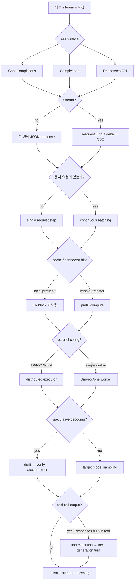
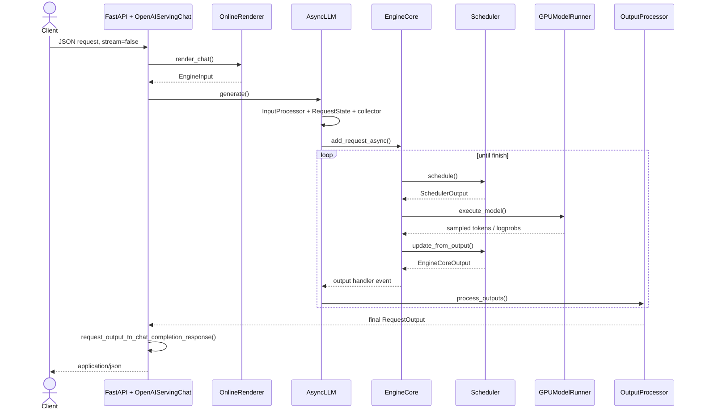
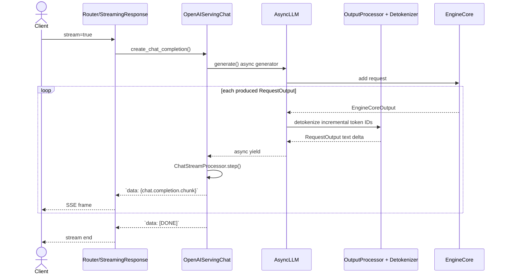
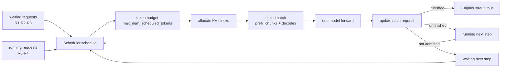
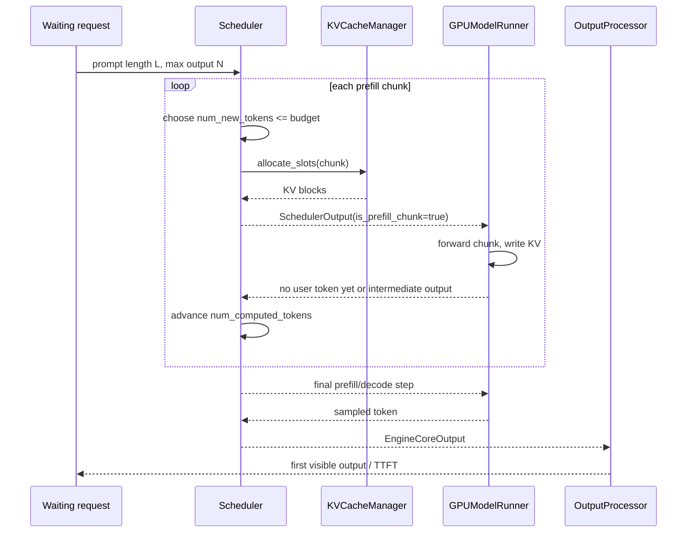
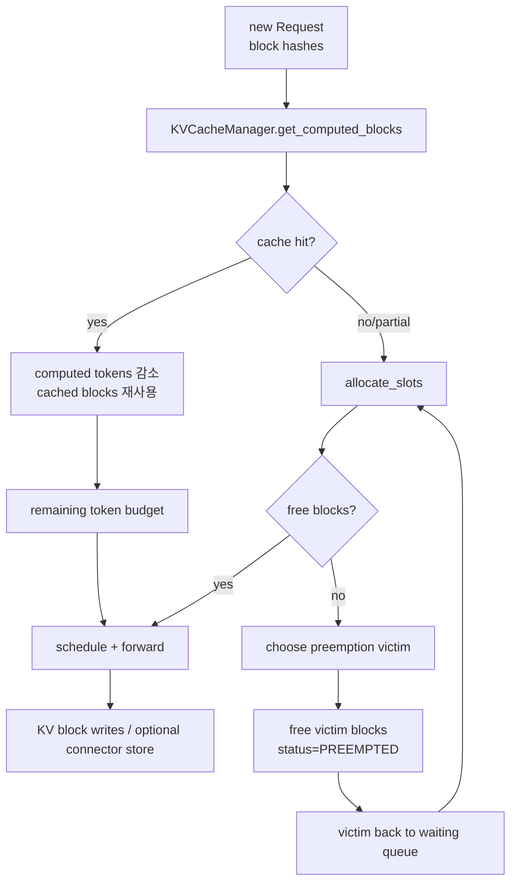
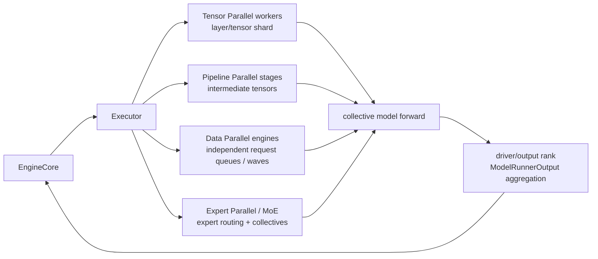
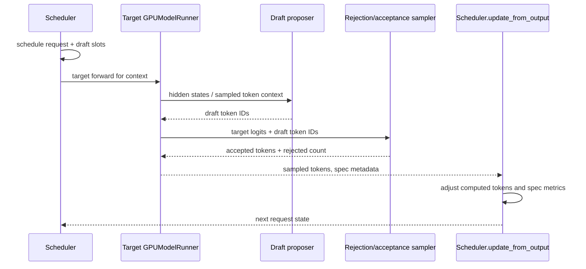
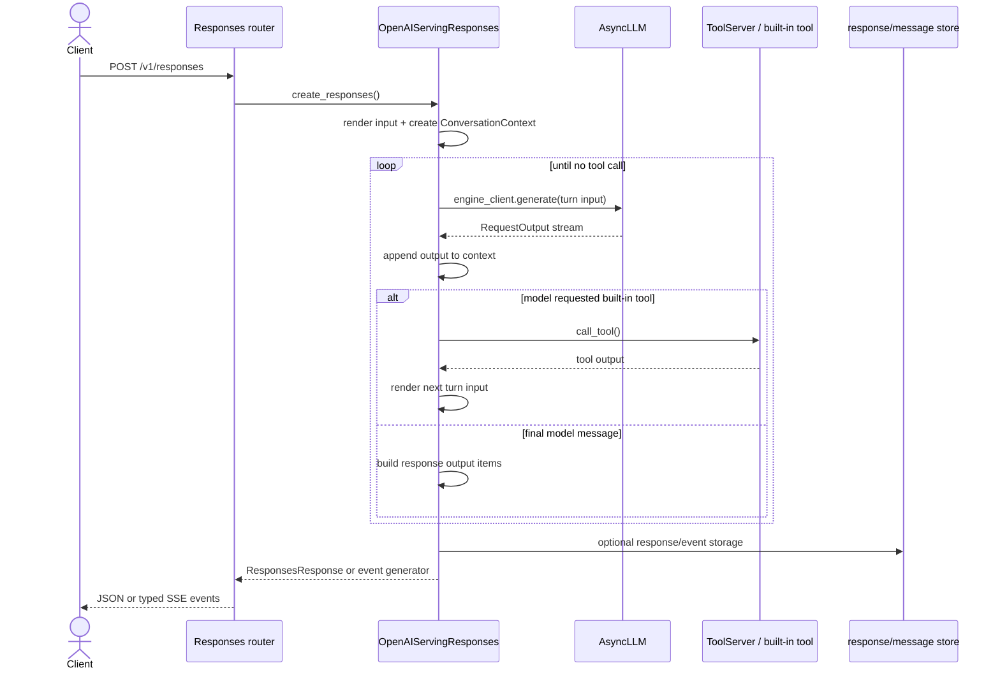
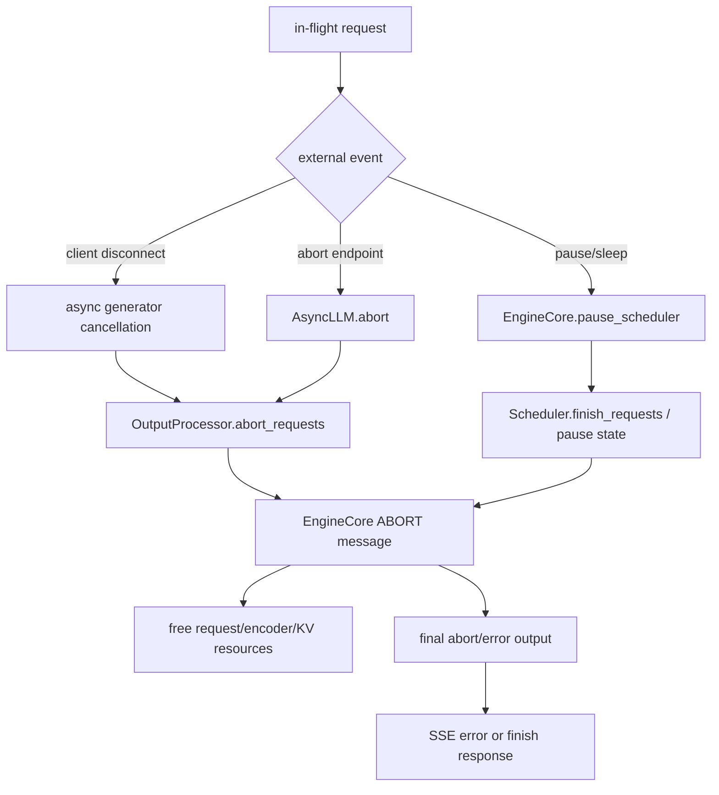

# vLLM 실행 시나리오 Reference

vLLM inference 경로가 요청 종류와 engine 설정에 따라 어떻게 달라지는지 시나리오별로 설명한다.

공통된 기본 경로는 [요청 생명주기](./vllm-request-lifecycle-reference.md)에 있고, 각 컴포넌트의 책임은 [모듈 카탈로그](./vllm-module-catalog-reference.md)에 정리되어 있다.

## 조사 기준

- upstream repository: [vllm-project/vllm](https://github.com/vllm-project/vllm)
- branch: `main`
- 조사 commit: [`fa3b9d1377219247060d3c8b49eae199c9e7e154`](https://github.com/vllm-project/vllm/commit/fa3b9d1377219247060d3c8b49eae199c9e7e154)
- 조사일: 2026-10-29
- 기준 실행 계층: V1 engine, OpenAI 호환 generate endpoint

## 시나리오 선택 지도

이 지도는 설정 선택을 설명하는 개념도이며 모든 endpoint와 backend 조합을 열거하지 않는다.

## 시나리오 1. 단일 non-streaming 요청

대표 입력은 `POST /v1/chat/completions` with `stream=false`이다.

핵심 특징:

- GPU는 요청이 끝날 때까지 여러 engine iteration을 수행할 수 있다.
- frontend는 중간 `RequestOutput`을 내부적으로 받을 수 있지만 API response는 마지막 결과만 반환한다.
- `RequestOutput.finished`와 `CompletionOutput.finish_reason`을 최종 완료 판정에 사용한다.
- prompt text와 prompt token IDs, usage, logprobs, finish reason이 최종 JSON envelope에 합쳐진다.

대표 source:

- [`OpenAIServingChat._create_chat_completion`](https://github.com/vllm-project/vllm/blob/fa3b9d1377219247060d3c8b49eae199c9e7e154/vllm/entrypoints/openai/chat_completion/serving.py)
- [`OpenAIServingCompletion.create_completion`](https://github.com/vllm-project/vllm/blob/fa3b9d1377219247060d3c8b49eae199c9e7e154/vllm/entrypoints/openai/completion/serving.py)
- [`AsyncLLM.generate`](https://github.com/vllm-project/vllm/blob/fa3b9d1377219247060d3c8b49eae199c9e7e154/vllm/v1/engine/async_llm.py)

## 시나리오 2. token streaming 요청

대표 입력은 `POST /v1/chat/completions` with `stream=true`이다.

streaming path에서 parser는 생성된 token을 content, reasoning, tool call delta로 나눌 수 있다.

stop string을 output에서 제외하는 설정이면 detokenizer가 stop buffer를 유지하므로 마지막 delta가 이전 token 경계와 정확히 일치하지 않을 수 있다.

`stream_interval`이 1보다 크면 여러 token을 하나의 `RequestOutput`으로 묶어 전송한다.

Responses API는 Chat Completions의 `[DONE]` 규칙 대신 `response.output_text.delta`, `response.completed`와 같은 typed event를 사용한다.

대표 source:

- [`chat_completion/stream_processor.py`](https://github.com/vllm-project/vllm/blob/fa3b9d1377219247060d3c8b49eae199c9e7e154/vllm/entrypoints/openai/chat_completion/stream_processor.py)
- [`chat_completion/serving.py`](https://github.com/vllm-project/vllm/blob/fa3b9d1377219247060d3c8b49eae199c9e7e154/vllm/entrypoints/openai/chat_completion/serving.py)
- [`detokenizer.py`](https://github.com/vllm-project/vllm/blob/fa3b9d1377219247060d3c8b49eae199c9e7e154/vllm/v1/engine/detokenizer.py)
- [`responses/api_router.py`](https://github.com/vllm-project/vllm/blob/fa3b9d1377219247060d3c8b49eae199c9e7e154/vllm/entrypoints/openai/responses/api_router.py)

## 시나리오 3. 여러 요청의 continuous batching

vLLM V1 scheduler는 매 iteration마다 waiting과 running request를 함께 보고 token budget 안에서 실행 batch를 구성한다.

현재 scheduler는 요청마다 `num_computed_tokens`와 `num_tokens_with_spec`의 차이를 계산한다.

이 표현은 다음을 하나의 scheduling rule로 포함한다.

- 긴 prompt를 여러 chunk로 나누는 chunked prefill
- 이미 계산된 prefix를 재사용하는 prefix cache
- draft token을 포함한 speculative decoding
- preempt 후 다시 계산하는 request

실행 batch에 prefill과 decode 요청이 함께 있을 수 있으므로 “prefill 단계가 모두 끝난 뒤 decode 단계가 시작된다”는 고정된 설명은 V1 scheduler의 일반 모델이 아니다.

대표 source:

- [`Scheduler.schedule`](https://github.com/vllm-project/vllm/blob/fa3b9d1377219247060d3c8b49eae199c9e7e154/vllm/v1/core/sched/scheduler.py)
- [`SchedulerOutput`](https://github.com/vllm-project/vllm/blob/fa3b9d1377219247060d3c8b49eae199c9e7e154/vllm/v1/core/sched/output.py)
- [`EngineCore.step`](https://github.com/vllm-project/vllm/blob/fa3b9d1377219247060d3c8b49eae199c9e7e154/vllm/v1/engine/core.py)

## 시나리오 4. chunked prefill과 긴 prompt

긴 prompt가 한 step의 input token budget을 초과하거나 다른 decode 요청의 지연을 줄여야 하면 scheduler가 prompt를 여러 chunk로 나눌 수 있다.

chunked prefill 중간 step은 user에게 빈 chunk를 반환하지 않도록 serving layer가 빈 output을 필터링할 수 있다.

prefill의 마지막 step에서만 logits와 sampled token이 의미 있는 응답으로 노출되는 모델도 있으므로, 첫 HTTP chunk가 곧 prompt 전체가 한 번에 실행됐다는 뜻은 아니다.

대표 source:

- [`Scheduler.schedule` prefill budget logic](https://github.com/vllm-project/vllm/blob/fa3b9d1377219247060d3c8b49eae199c9e7e154/vllm/v1/core/sched/scheduler.py)
- [`OpenAIServingCompletion.completion_stream_generator`](https://github.com/vllm-project/vllm/blob/fa3b9d1377219247060d3c8b49eae199c9e7e154/vllm/entrypoints/openai/completion/serving.py)

## 시나리오 5. prefix cache, block allocation, preemption

prefix caching은 같은 prefix가 다시 들어왔을 때 KV block 계산을 재사용하는 흐름이다.

`KVCacheManager`는 logical block handle과 cache hit를 관리하고, GPU worker는 block table과 physical KV tensors를 사용한다.

block이 부족하면 scheduler가 policy에 따라 running request를 preempt하고 waiting queue에 되돌린다.

preempt된 request는 `num_computed_tokens`와 speculative state를 조정한 뒤 다음 step에서 prompt 또는 output prefix를 다시 계산할 수 있다.

KV connector가 설정되면 scheduler와 worker 사이에 local cache 이외의 load/store metadata가 추가되고, remote prefill/decode나 CPU offload가 이 경계에서 수행된다.

대표 source:

- [`kv_cache_manager.py`](https://github.com/vllm-project/vllm/blob/fa3b9d1377219247060d3c8b49eae199c9e7e154/vllm/v1/core/kv_cache_manager.py)
- [`block_pool.py`](https://github.com/vllm-project/vllm/blob/fa3b9d1377219247060d3c8b49eae199c9e7e154/vllm/v1/core/block_pool.py)
- [`Scheduler._preempt_request`](https://github.com/vllm-project/vllm/blob/fa3b9d1377219247060d3c8b49eae199c9e7e154/vllm/v1/core/sched/scheduler.py)
- [`KV connector V1`](https://github.com/vllm-project/vllm/tree/fa3b9d1377219247060d3c8b49eae199c9e7e154/vllm/distributed/kv_transfer/kv_connector/v1)

## 시나리오 6. distributed execution

vLLM은 같은 scheduler 계획을 하나 이상의 worker와 parallel group에 전달할 수 있다.

`Executor.get_class()`는 `uni`, `mp`, `ray`, external launcher backend 중 하나를 선택한다.

MultiprocExecutor는 worker process와 message queue를 만들고, `execute_model` 결과는 output rank 또는 KV/encoder connector aggregator를 거쳐 core로 돌아온다.

Pipeline parallel에서는 마지막 stage가 logits를 계산하고, 중간 stage는 intermediate tensors를 다음 stage에 전달한다.

Data parallel은 여러 EngineCore가 request wave와 global unfinished state를 동기화할 수 있으며, 내부 load balancer 또는 external load balancer 구성이 추가될 수 있다.

대표 source:

- [`Executor.get_class`](https://github.com/vllm-project/vllm/blob/fa3b9d1377219247060d3c8b49eae199c9e7e154/vllm/v1/executor/abstract.py)
- [`MultiprocExecutor`](https://github.com/vllm-project/vllm/blob/fa3b9d1377219247060d3c8b49eae199c9e7e154/vllm/v1/executor/multiproc_executor.py)
- [`EngineCoreProc`](https://github.com/vllm-project/vllm/blob/fa3b9d1377219247060d3c8b49eae199c9e7e154/vllm/v1/engine/core.py)
- [`distributed`](https://github.com/vllm-project/vllm/tree/fa3b9d1377219247060d3c8b49eae199c9e7e154/vllm/distributed)

## 시나리오 7. speculative decoding

speculative decoding은 draft token을 먼저 제안하고 target model이 여러 token을 한 번에 검증하는 경로다.

V1 scheduler는 `num_tokens_with_spec`에 draft token을 포함해 다음 step의 token budget을 계산한다.

검증에서 rejected draft token이 있으면 scheduler가 `num_computed_tokens`와 output placeholder를 되돌려 target model이 올바른 위치에서 다시 계산하도록 한다.

grammar-constrained request에서는 structured output bitmask가 draft token 허용 수와 함께 고려된다.

대표 source:

- [`vllm/v1/spec_decode`](https://github.com/vllm-project/vllm/tree/fa3b9d1377219247060d3c8b49eae199c9e7e154/vllm/v1/spec_decode)
- [`GPUModelRunner.sample_tokens`](https://github.com/vllm-project/vllm/blob/fa3b9d1377219247060d3c8b49eae199c9e7e154/vllm/v1/worker/gpu_model_runner.py)
- [`Scheduler.update_from_output`](https://github.com/vllm-project/vllm/blob/fa3b9d1377219247060d3c8b49eae199c9e7e154/vllm/v1/core/sched/scheduler.py)

## 시나리오 8. Responses API built-in tool loop

Responses API는 하나의 HTTP 요청 안에서 여러 inference turn을 만들 수 있다.

각 tool turn은 `engine_client.generate()`를 다시 호출하므로 하나의 HTTP request가 하나의 model forward만 의미하지 않는다.

tool output은 다음 turn의 prompt history에 렌더링되고, `priority`를 낮춰 후속 sub-request를 구분할 수 있다.

Responses store는 vLLM 설정과 환경 변수에 따라 비활성화될 수 있으며, OpenAI 기본 동작과 같은 persistence를 항상 제공한다고 가정하면 안 된다.

대표 source:

- [`OpenAIServingResponses._generate_with_builtin_tools`](https://github.com/vllm-project/vllm/blob/fa3b9d1377219247060d3c8b49eae199c9e7e154/vllm/entrypoints/openai/responses/serving.py)
- [`ResponsesContext`](https://github.com/vllm-project/vllm/blob/fa3b9d1377219247060d3c8b49eae199c9e7e154/vllm/entrypoints/openai/responses/context.py)
- [`responses/api_router.py`](https://github.com/vllm-project/vllm/blob/fa3b9d1377219247060d3c8b49eae199c9e7e154/vllm/entrypoints/openai/responses/api_router.py)

## 시나리오 9. client disconnect, abort, pause

요청 중 연결이 끊기거나 운영 API가 abort/pause를 호출하면 request 상태와 device 실행 상태를 정리해야 한다.

stream이 이미 시작된 뒤에는 HTTP status code를 바꿀 수 없으므로 request-level error 또는 SSE error event로 결과를 전달한다.

pause 상태에서는 새 요청을 거절하거나 queue에 보류할 수 있고, `mode=abort`, `wait`, `keep`가 in-flight request 처리 방식을 바꾼다.

대표 source:

- [`AsyncLLM.abort`](https://github.com/vllm-project/vllm/blob/fa3b9d1377219247060d3c8b49eae199c9e7e154/vllm/v1/engine/async_llm.py)
- [`EngineCore.pause_scheduler`](https://github.com/vllm-project/vllm/blob/fa3b9d1377219247060d3c8b49eae199c9e7e154/vllm/v1/engine/core.py)
- [`OutputProcessor.abort_requests`](https://github.com/vllm-project/vllm/blob/fa3b9d1377219247060d3c8b49eae199c9e7e154/vllm/v1/engine/output_processor.py)

## 시나리오별 비교

| 시나리오 | 핵심 추가 상태 | 주요 병목 또는 위험 | 최종 출력 경로 |
| --- | --- | --- | --- |
| 단일 non-streaming | one request state, one final collector result | TTFT와 전체 latency | JSON response |
| streaming | collector, incremental detokenizer, parser state | chunk granularity, disconnect | SSE delta |
| continuous batching | waiting/running queues, token budget | fairness, preemption, KV capacity | request별 interleaved outputs |
| chunked prefill | `is_prefill_chunk`, computed tokens | long prompt TTFT, decode starvation | first token 이후 streaming |
| prefix cache | block hashes, block table | cache pressure, invalidation | cached + computed token mix |
| distributed | TP/PP/DP/EP groups, output rank | collectives, worker failure | aggregated `ModelRunnerOutput` |
| speculative decoding | draft slots, accepted/rejected counts | rollback, grammar compatibility | multiple token IDs per step |
| built-in tool loop | conversation context, sub-request IDs | repeated generation/tool latency | multi-event Responses output |
| abort/pause | request finish state, pause state | in-flight cleanup ordering | error/abort finish |

## 시나리오를 조사할 때 확인할 순서

1. endpoint router가 어떤 serving handler를 호출하는지 확인한다.
2. serving handler가 `OnlineRenderer`를 통해 어떤 `EngineInput`을 만드는지 확인한다.
3. `AsyncLLM.generate()`가 request collector와 EngineCore request를 어떻게 연결하는지 확인한다.
4. `Scheduler.schedule()`이 token budget과 KV block을 어떻게 배정하는지 확인한다.
5. executor backend가 worker를 어느 프로세스와 device에 배치하는지 확인한다.
6. `GPUModelRunner.execute_model()`과 `sample_tokens()`이 forward·sampling·spec decode를 어떻게 나누는지 확인한다.
7. `OutputProcessor.process_outputs()`와 API serving generator가 token을 JSON/SSE로 어떻게 재구성하는지 확인한다.

## 버전 드리프트 주의사항

- scheduler 알고리즘은 V1에서 계속 확장되고 있으므로 prefill/decode 설명을 구현 불변의 phase model로 고정하지 않는다.
- `GPUModelRunner`와 V2 model runner, backend별 attention implementation은 같은 high-level contract를 공유해도 내부 tensor layout이 다를 수 있다.
- distributed 실행의 실제 process graph는 executor backend와 data-parallel launcher에 따라 달라진다.
- Responses tool loop와 store 동작은 vLLM 환경 변수, model capability, tool parser 설정에 따라 달라진다.
- API stream event의 세부 필드와 finish reason은 조사 commit 이후 변경될 수 있으므로 소스 commit을 함께 기록한다.
