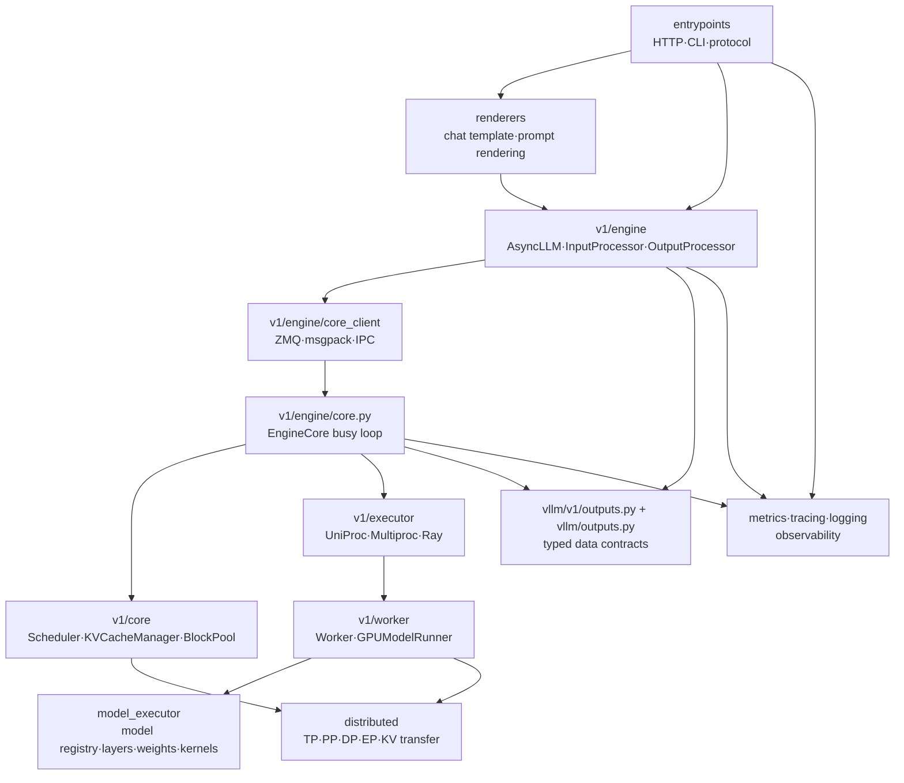
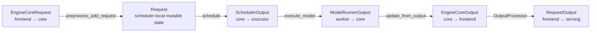
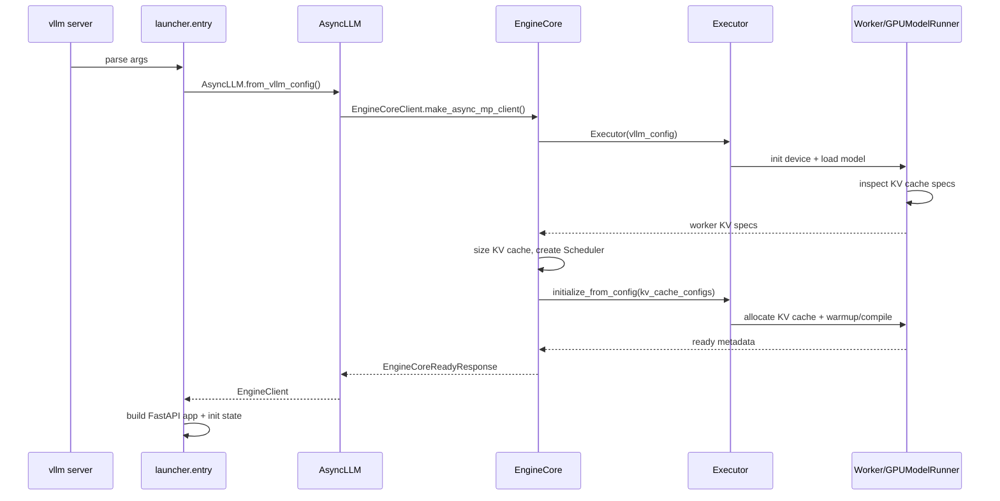

# vLLM 모듈 카탈로그 Reference

vLLM `main`의 inference stack을 패키지와 책임 단위로 분해해 정리한다.

요청이 실제로 시간 순서대로 어떻게 이동하는지는 [요청 생명주기](./vllm-request-lifecycle-reference.md)를, 설정별 실행 분기는 [실행 시나리오](./vllm-execution-scenarios-reference.md)를 참고한다.

## 조사 기준

- upstream repository: [vllm-project/vllm](https://github.com/vllm-project/vllm)
- branch: `main`
- 조사 commit: [`fa3b9d1377219247060d3c8b49eae199c9e7e154`](https://github.com/vllm-project/vllm/commit/fa3b9d1377219247060d3c8b49eae199c9e7e154)
- 조사일: 2026-10-29
- 주 경로: V1 engine, OpenAI 호환 generate API

아래 카탈로그에서 패키지와 클래스는 논리 책임 단위이며 실제 프로세스 경계는 executor·multiprocessing·Ray·설정에 따라 달라진다.

## 패키지 계층

핵심 의존 방향은 **외부 protocol → 렌더링·frontend → core scheduling → executor·worker → model execution → output conversion**이다.

모델 구현이 API protocol을 직접 알지 않도록 `EngineCoreRequest`, `SchedulerOutput`, `ModelRunnerOutput`, `EngineCoreOutput`, `RequestOutput`이 계층 간 데이터 계약 역할을 한다.

## 역할별 모듈 카탈로그

### API와 protocol 계층

| 모듈 | 주요 구성 요소 | 책임 | 대표 입력·출력 |
| --- | --- | --- | --- |
| `vllm/entrypoints/launchers/api_server/entry.py` | `build_async_engine_client`, `build_and_serve`, `run_server` | CLI 인자에서 engine config를 만들고 AsyncLLM·FastAPI를 조립 | CLI args → running server |
| `vllm/entrypoints/launchers/app.py` | `build_app` | FastAPI app, router, exception handler, middleware 조립 | `Namespace` → `FastAPI` |
| `vllm/entrypoints/generate/api_router.py` | `register_generate_api_routers`, `init_generate_state` | chat/completion/Responses router 등록과 serving object 생성 | app state → route handlers |
| `vllm/entrypoints/openai/chat_completion/api_router.py` | `create_chat_completion` | `/v1/chat/completions` JSON/SSE route | `ChatCompletionRequest` → response |
| `vllm/entrypoints/openai/completion/api_router.py` | `create_completion` | `/v1/completions` JSON/SSE route | `CompletionRequest` → response |
| `vllm/entrypoints/openai/responses/api_router.py` | `create_responses` | `/v1/responses` JSON/SSE event route | `ResponsesRequest` → response/event |
| `vllm/entrypoints/openai/*/protocol.py` | Pydantic protocol models | external wire schema와 validation | JSON ↔ typed request/response |

관련 링크:

- [`entry.py`](https://github.com/vllm-project/vllm/blob/fa3b9d1377219247060d3c8b49eae199c9e7e154/vllm/entrypoints/launchers/api_server/entry.py)
- [`app.py`](https://github.com/vllm-project/vllm/blob/fa3b9d1377219247060d3c8b49eae199c9e7e154/vllm/entrypoints/launchers/app.py)
- [`generate/api_router.py`](https://github.com/vllm-project/vllm/blob/fa3b9d1377219247060d3c8b49eae199c9e7e154/vllm/entrypoints/generate/api_router.py)
- [`openai/chat_completion/api_router.py`](https://github.com/vllm-project/vllm/blob/fa3b9d1377219247060d3c8b49eae199c9e7e154/vllm/entrypoints/openai/chat_completion/api_router.py)

### serving과 rendering 계층

| 모듈 | 주요 구성 요소 | 책임 | 주요 경계 |
| --- | --- | --- | --- |
| `vllm/entrypoints/openai/chat_completion/serving.py` | `OpenAIServingChat` | chat request preflight, render, sampling param, generator, chat response assembly | API request ↔ `engine_client.generate()` |
| `vllm/entrypoints/openai/completion/serving.py` | `OpenAIServingCompletion` | completion request와 text completion response assembly | API request ↔ `engine_client.generate()` |
| `vllm/entrypoints/openai/responses/serving.py` | `OpenAIServingResponses` | Responses context, response store, streaming events, built-in tool loop | Responses request ↔ one or more generation turns |
| `vllm/renderers/online_renderer.py` | `OnlineRenderer` | chat template, input message normalization, tool/reasoning parser selection, `EngineInput` 생성 | protocol payload ↔ renderer input |
| `vllm/renderers/` | `BaseRenderer`, tokenizer adapters, chat utilities | tokenizer와 model-specific render path 제공 | prompt/messages ↔ token IDs |
| `vllm/parser/` | tool parser, reasoning parser | 생성 token/text에서 tool call·reasoning stream 추출 | `CompletionOutput` ↔ API delta |

`OnlineRenderer`는 요청을 모델이 소비하는 prompt 구조로 바꾸지만 실제 scheduler admission이나 GPU 실행을 수행하지 않는다.

`OpenAIServingResponses._generate_with_builtin_tools()`는 모델 output을 tool call로 판정하면 tool을 호출하고 다음 generation turn을 별도로 시작한다.

관련 링크:

- [`OpenAIServingChat`](https://github.com/vllm-project/vllm/blob/fa3b9d1377219247060d3c8b49eae199c9e7e154/vllm/entrypoints/openai/chat_completion/serving.py)
- [`OpenAIServingResponses`](https://github.com/vllm-project/vllm/blob/fa3b9d1377219247060d3c8b49eae199c9e7e154/vllm/entrypoints/openai/responses/serving.py)
- [`OnlineRenderer`](https://github.com/vllm-project/vllm/blob/fa3b9d1377219247060d3c8b49eae199c9e7e154/vllm/renderers/online_renderer.py)
- [`parser`](https://github.com/vllm-project/vllm/tree/fa3b9d1377219247060d3c8b49eae199c9e7e154/vllm/parser)

### frontend engine 계층

| 모듈 | 주요 구성 요소 | 책임 | 생성하는 데이터 |
| --- | --- | --- | --- |
| `vllm/v1/engine/async_llm.py` | `AsyncLLM` | async API용 engine facade, admission, request collector, output handler | `EngineCoreRequest`, `RequestOutput` stream |
| `vllm/v1/engine/input_processor.py` | `InputProcessor` | params 검증·clone, prompt normalization, multimodal metadata, request ID | `EngineCoreRequest` |
| `vllm/v1/engine/output_processor.py` | `OutputProcessor`, `RequestState`, `RequestOutputCollector` | core output 처리, detokenization 호출, finish/abort cleanup | `RequestOutput` |
| `vllm/v1/engine/detokenizer.py` | `IncrementalDetokenizer` | token IDs → incremental text, stop string 감지 | text delta, stop reason |
| `vllm/v1/engine/core_client.py` | `EngineCoreClient`, `AsyncMPClient`, `SyncMPClient`, `InprocClient` | frontend와 EngineCore 간 요청·응답 transport 추상화 | `EngineCoreRequest`, `EngineCoreOutputs` |
| `vllm/v1/engine/llm_engine.py` | `LLMEngine` | legacy synchronous/in-process API compatibility | `RequestOutput` list |
| `vllm/engine/protocol.py` | `EngineClient` | entrypoint가 의존하는 engine interface | `generate()` async generator |

`AsyncLLM.generate()`는 입력을 등록한 뒤 output handler가 request queue에 넣은 `RequestOutput`을 async generator로 소비한다.

이 구조 때문에 serving handler는 GPU step의 동기 세부사항을 알 필요가 없다.

관련 링크:

- [`async_llm.py`](https://github.com/vllm-project/vllm/blob/fa3b9d1377219247060d3c8b49eae199c9e7e154/vllm/v1/engine/async_llm.py)
- [`input_processor.py`](https://github.com/vllm-project/vllm/blob/fa3b9d1377219247060d3c8b49eae199c9e7e154/vllm/v1/engine/input_processor.py)
- [`output_processor.py`](https://github.com/vllm-project/vllm/blob/fa3b9d1377219247060d3c8b49eae199c9e7e154/vllm/v1/engine/output_processor.py)
- [`detokenizer.py`](https://github.com/vllm-project/vllm/blob/fa3b9d1377219247060d3c8b49eae199c9e7e154/vllm/v1/engine/detokenizer.py)
- [`core_client.py`](https://github.com/vllm-project/vllm/blob/fa3b9d1377219247060d3c8b49eae199c9e7e154/vllm/v1/engine/core_client.py)

### EngineCore와 request contract 계층

| 모듈 | 주요 구성 요소 | 책임 |
| --- | --- | --- |
| `vllm/v1/engine/__init__.py` | `EngineCoreRequest`, `EngineCoreOutput`, `EngineCoreOutputs`, `FinishReason` | msgspec 기반 compact wire/data contract |
| `vllm/v1/request.py` | `Request`, `RequestStatus` | scheduler가 유지하는 request state, token·cache·status bookkeeping |
| `vllm/v1/engine/core.py` | `EngineCore`, `EngineCoreProc` | model executor 초기화, busy loop, schedule→execute→update loop |
| `vllm/v1/engine/coordinator.py` | `DPCoordinator` | data-parallel frontend/core coordination |
| `vllm/v1/engine/admission_control.py` | `SharedAdmissionStats` | API client 간 queued request 통계 공유 |

`Request`는 `WAITING`, `RUNNING`, `PREEMPTED`, finished status와 `num_computed_tokens`, `spec_token_ids`, `block_hashes`를 함께 관리한다.

`EngineCoreOutput`은 외부 JSON이 아니라 frontend output processor가 다시 detokenize하고 API schema로 변환하는 내부 계약이다.

관련 링크:

- [`v1/engine/__init__.py`](https://github.com/vllm-project/vllm/blob/fa3b9d1377219247060d3c8b49eae199c9e7e154/vllm/v1/engine/__init__.py)
- [`v1/request.py`](https://github.com/vllm-project/vllm/blob/fa3b9d1377219247060d3c8b49eae199c9e7e154/vllm/v1/request.py)
- [`v1/engine/core.py`](https://github.com/vllm-project/vllm/blob/fa3b9d1377219247060d3c8b49eae199c9e7e154/vllm/v1/engine/core.py)

### scheduler와 KV cache 계층

| 모듈 | 주요 구성 요소 | 책임 | 상태 |
| --- | --- | --- | --- |
| `vllm/v1/core/sched/scheduler.py` | `Scheduler` | waiting/running queue, token budget, preemption, request finish, connector metadata | request scheduling state |
| `vllm/v1/core/sched/output.py` | `SchedulerOutput` | executor에 전달할 한 step 계획 | scheduled request/token/block |
| `vllm/v1/core/kv_cache_manager.py` | `KVCacheManager` | prefix cache lookup, block allocation/free, cache usage | logical KV blocks |
| `vllm/v1/core/block_pool.py` | `BlockPool` | physical block pool과 free/used state | block IDs |
| `vllm/v1/core/kv_cache_coordinator.py` | `KVCacheCoordinator`, hybrid coordinator | attention/mamba/cache group orchestration | multi-group cache |
| `vllm/v1/core/encoder_cache_manager.py` | `EncoderCacheManager` | multimodal/encoder output cache admission | encoder cache entries |
| `vllm/distributed/kv_transfer/` | KV connectors | remote prefill/decode, offload, transfer metadata | external KV state |

현재 scheduler는 prefill과 decode를 별도 global phase로 고정하지 않고 request별 computed-token gap을 사용한다.

`KVCacheManager.get_computed_blocks()`는 prefix block hit를 찾아 scheduler가 다시 계산할 token 수를 줄인다.

관련 링크:

- [`scheduler.py`](https://github.com/vllm-project/vllm/blob/fa3b9d1377219247060d3c8b49eae199c9e7e154/vllm/v1/core/sched/scheduler.py)
- [`kv_cache_manager.py`](https://github.com/vllm-project/vllm/blob/fa3b9d1377219247060d3c8b49eae199c9e7e154/vllm/v1/core/kv_cache_manager.py)
- [`block_pool.py`](https://github.com/vllm-project/vllm/blob/fa3b9d1377219247060d3c8b49eae199c9e7e154/vllm/v1/core/block_pool.py)
- [`KV transfer connectors`](https://github.com/vllm-project/vllm/tree/fa3b9d1377219247060d3c8b49eae199c9e7e154/vllm/distributed/kv_transfer)

### executor 계층

| 모듈 | 주요 구성 요소 | 선택 조건 | 역할 |
| --- | --- | --- | --- |
| `vllm/v1/executor/abstract.py` | `Executor` | 공통 base | worker RPC, model execution, KV spec, warmup interface |
| `vllm/v1/executor/uniproc_executor.py` | `UniProcExecutor` | single process 또는 작은 구성 | 한 driver worker에 직접 RPC |
| `vllm/v1/executor/multiproc_executor.py` | `MultiprocExecutor` | `distributed_executor_backend=mp` | worker process, message queue, TP/PP orchestration |
| `vllm/v1/executor/ray_executor_v2.py` | `RayExecutorV2` | `distributed_executor_backend=ray` | Ray actor 기반 분산 worker orchestration |
| `vllm/v1/executor/external_launcher` 경로 | `ExecutorWithExternalLauncher` | external launcher | torchrun 계열 외부 프로세스와 협력 |

`Executor.get_class()`가 실제 executor를 선택하고, `EngineCore`는 선택된 executor에 `SchedulerOutput`만 전달한다.

Executor는 model-specific Python layer를 직접 구현하지 않고 worker interface를 통해 `execute_model`, `sample_tokens`, `collective_rpc`를 제공한다.

관련 링크:

- [`abstract.py`](https://github.com/vllm-project/vllm/blob/fa3b9d1377219247060d3c8b49eae199c9e7e154/vllm/v1/executor/abstract.py)
- [`uniproc_executor.py`](https://github.com/vllm-project/vllm/blob/fa3b9d1377219247060d3c8b49eae199c9e7e154/vllm/v1/executor/uniproc_executor.py)
- [`multiproc_executor.py`](https://github.com/vllm-project/vllm/blob/fa3b9d1377219247060d3c8b49eae199c9e7e154/vllm/v1/executor/multiproc_executor.py)
- [`ray_executor_v2.py`](https://github.com/vllm-project/vllm/blob/fa3b9d1377219247060d3c8b49eae199c9e7e154/vllm/v1/executor/ray_executor_v2.py)

### worker와 model execution 계층

| 모듈 | 주요 구성 요소 | 책임 |
| --- | --- | --- |
| `vllm/v1/worker/worker_base.py` | `WorkerBase` | worker lifecycle, model runner common hooks |
| `vllm/v1/worker/gpu_worker.py` | `Worker` | device init, model load, KV cache init, distributed groups |
| `vllm/v1/worker/gpu_model_runner.py` | `GPUModelRunner` | input batch, block table, attention metadata, forward, logits, sample |
| `vllm/v1/worker/cpu_model_runner.py` | CPU runner | CPU backend execution |
| `vllm/v1/worker/xpu_model_runner.py` | XPU runner | XPU backend execution |
| `vllm/model_executor/model_loader/` | loaders | checkpoint/weight loading, quantized weight setup |
| `vllm/model_executor/models/` | model classes | model architecture forward, `compute_logits`, optional pooling/vision |
| `vllm/model_executor/layers/` | attention, MoE, linear, norm, sampler support | optimized model operations |
| `vllm/v1/sample/` | sampler, logits processors, rejection sampler | logits constraints and token selection |

GPUModelRunner의 일반 경로는 `execute_model()`에서 input preparation과 model forward를 수행하고 `sample_tokens()`에서 grammar mask와 sampling을 수행한다.

관련 링크:

- [`gpu_worker.py`](https://github.com/vllm-project/vllm/blob/fa3b9d1377219247060d3c8b49eae199c9e7e154/vllm/v1/worker/gpu_worker.py)
- [`gpu_model_runner.py`](https://github.com/vllm-project/vllm/blob/fa3b9d1377219247060d3c8b49eae199c9e7e154/vllm/v1/worker/gpu_model_runner.py)
- [`model_loader`](https://github.com/vllm-project/vllm/tree/fa3b9d1377219247060d3c8b49eae199c9e7e154/vllm/model_executor/model_loader)
- [`model implementations`](https://github.com/vllm-project/vllm/tree/fa3b9d1377219247060d3c8b49eae199c9e7e154/vllm/model_executor/models)
- [`sampler`](https://github.com/vllm-project/vllm/tree/fa3b9d1377219247060d3c8b49eae199c9e7e154/vllm/v1/sample)

## 초기화 경로와 hot path

### 초기화 경로

모델 weight load와 KV cache sizing은 request hot path보다 먼저 실행된다.

EngineCore 초기화 중에는 model executor가 KV cache spec과 available memory를 제공하고, scheduler가 사용할 block size와 capacity가 이 결과로 결정된다.

### request hot path

```mermaid
flowchart LR
    Add["add_request"] --> Pre["InputProcessor"]
    Pre --> State["OutputProcessor RequestState"]
    Pre --> Wire["EngineCoreRequest"]
    Wire --> Queue["EngineCore input queue"]
    Queue --> Schedule["Scheduler.schedule"]
    Schedule --> Exec["Executor.execute_model"]
    Exec --> Forward["GPUModelRunner.forward"]
    Forward --> Sample["GPUModelRunner.sample_tokens"]
    Sample --> Update["Scheduler.update_from_output"]
    Update --> ECO["EngineCoreOutput"]
    ECO --> Detok["OutputProcessor + Detokenizer"]
    Detok --> Collect["RequestOutputCollector"]
    Collect --> API["Serving formatter"]
```

hot path에서 scheduler와 model runner가 공유하는 핵심 상태는 request ID, computed token 수, block table, sampled token IDs, finish status이다.

## 실행 위치와 프로세스 경계

| 논리 구성 요소 | 일반적인 실행 위치 | 비고 |
| --- | --- | --- |
| FastAPI router | API server frontend process | HTTP parsing, JSON/SSE |
| OpenAI serving + OnlineRenderer | frontend process | template, parser, response assembly |
| AsyncLLM | frontend process | request collector, output handler |
| AsyncMPClient | frontend process | ZMQ client, msgpack |
| EngineCoreProc | background engine process | scheduler, KV manager, core busy loop |
| MultiprocExecutor workers | 별도 worker processes | model, GPU memory, forward/sampling |
| RayExecutorV2 workers | Ray actors/processes | backend 선택 시 |
| InprocClient/LLMEngine | 한 프로세스 논리 구성 | legacy/offline 경로에서 가능 |

이 표는 대표 배치이며 API server worker 수, external launcher, Ray, data parallel supervisor 설정에 따라 프로세스 수와 host가 달라진다.

## 의존 경계를 읽는 법

1. API layer는 `EngineClient.generate()`와 protocol model을 사용한다.
2. frontend engine layer는 renderer와 tokenizer를 사용해 `EngineCoreRequest`를 만든다.
3. EngineCore는 scheduler와 executor를 조율하지만 model-specific class를 직접 호출하지 않는다.
4. Scheduler는 KV cache manager에 block allocation을 요청하고 `SchedulerOutput`으로 계획을 고정한다.
5. Executor와 worker는 device 실행을 담당하고 `ModelRunnerOutput`으로 반환한다.
6. OutputProcessor는 model output을 외부 API가 이해하는 text/logprob/finish 구조로 변환한다.

## 버전 드리프트 주의사항

- `vllm/entrypoints/openai/api_server.py`는 deprecated compatibility wrapper로 바뀔 수 있다.
- V1과 legacy V0의 engine class가 공존할 수 있으므로 모든 배포가 같은 call graph를 사용한다고 가정하지 않는다.
- `GPUModelRunner`와 `GPUModelRunnerV2` 선택은 환경 변수와 backend에 따라 달라질 수 있다.
- Executor, worker, KV connector는 hardware·parallel configuration에 따라 실제 경계가 달라진다.
- API protocol의 필드와 Responses/tool 지원 범위는 vLLM commit과 model config에 따라 달라질 수 있다.
