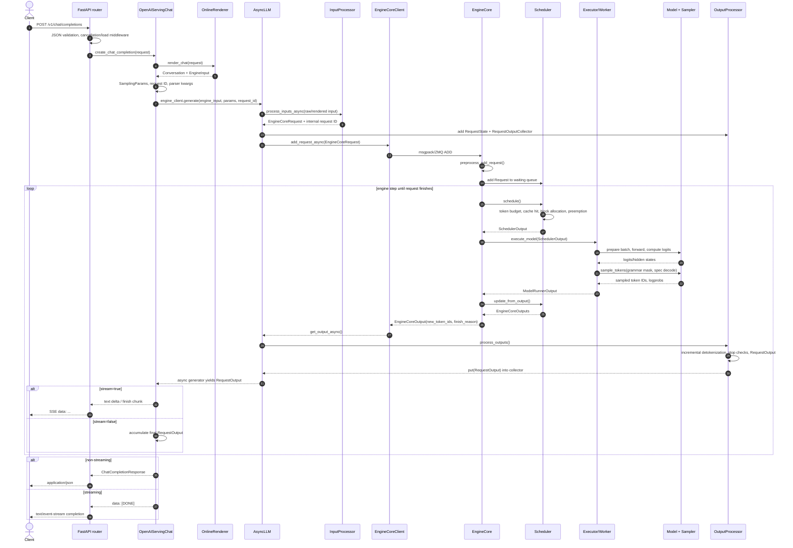

# vLLM 요청 생명주기 Reference

vLLM `main`에서 OpenAI 호환 HTTP 요청이 LLM inference를 거쳐 JSON 또는 SSE 응답으로 바뀌는 경로를 시간 순서로 설명한다.

이 문서는 요청 생명주기를 기준으로 읽고, 모듈 책임을 빠르게 찾으려면 [모듈 카탈로그](./vllm-module-catalog-reference.md)를, 설정별 분기를 비교하려면 [실행 시나리오](./vllm-execution-scenarios-reference.md)를 함께 본다.

## 조사 기준과 범위

- upstream repository: [vllm-project/vllm](https://github.com/vllm-project/vllm)
- branch: `main`
- 조사 commit: [`fa3b9d1377219247060d3c8b49eae199c9e7e154`](https://github.com/vllm-project/vllm/commit/fa3b9d1377219247060d3c8b49eae199c9e7e154)
- 조사일: 2026-10-29
- 기본 경로: V1 engine, `vllm server`, OpenAI 호환 generate API
- 응답 표면: `/v1/chat/completions`, `/v1/completions`, `/v1/responses`

이 문서는 소스의 핵심 경계를 설명하는 reference이며 모든 모델별 subclass와 모든 분산 backend의 세부 구현을 나열하지 않는다.

`vllm.entrypoints.openai.api_server`는 현재 deprecated wrapper이므로 서버 진입점은 `vllm.entrypoints.launchers.api_server.entry`와 `vllm server` 명령을 기준으로 설명한다.

## 전체 흐름

```mermaid
flowchart LR
    Client["외부 client<br/>HTTP JSON"]
    Router["FastAPI router<br/>/v1/chat/completions<br/>/v1/completions<br/>/v1/responses"]
    Serving["OpenAI serving handler<br/>입력 검증·응답 조립"]
    Renderer["OnlineRenderer<br/>chat template·tool/reasoning parser<br/>EngineInput 생성"]
    AsyncLLM["AsyncLLM<br/>admission·request collector<br/>generate()"]
    Input["InputProcessor<br/>token IDs·multimodal·SamplingParams"]
    CoreClient["EngineCoreClient<br/>AsyncMPClient·ZMQ/msgpack"]
    Core["EngineCore busy loop<br/>request queue·step()"]
    Scheduler["Scheduler<br/>waiting/running queue<br/>token budget·preemption"]
    KV["KVCacheManager<br/>block allocation·prefix hit<br/>KV connector metadata"]
    Executor["Executor<br/>UniProc·Multiproc·Ray"]
    Worker["Worker / GPUModelRunner<br/>input batch·attention metadata"]
    Model["model forward<br/>model_executor/models"]
    Sampler["logits·grammar mask·sampler<br/>token IDs·logprobs"]
    CoreOutput["EngineCoreOutput<br/>new_token_ids·finish_reason"]
    Output["OutputProcessor<br/>stats·IncrementalDetokenizer<br/>RequestOutputCollector"]
    APIOutput["OpenAI response builder<br/>JSON 또는 SSE framing"]

    Client --> Router --> Serving --> Renderer --> AsyncLLM
    AsyncLLM --> Input --> CoreClient --> Core
    Core --> Scheduler
    Scheduler --> KV
    Scheduler --> Executor
    Executor --> Worker --> Model --> Sampler
    Sampler --> CoreOutput --> Output --> APIOutput --> Client
    Output -."stop string·abort".-> Core
    Core -."SchedulerOutput".-> Executor
    KV -."block table·cache state".-> Worker
```

상자들은 논리 컴포넌트이며 모두 별도 OS 프로세스라는 뜻은 아니다.

일반적인 OpenAI 서버 구성에서는 API server frontend와 EngineCore가 multiprocessing과 ZMQ로 분리되지만, `LLMEngine`의 legacy·in-process 경로에서는 `InprocClient`가 EngineCore를 같은 프로세스에 둘 수 있다.

`AsyncLLM`은 API 호출자가 직접 GPU를 실행하지 않고, 입력을 `EngineCoreRequest`로 변환해 EngineCore에 전달한다.

## 요청부터 응답까지의 순서

아래 sequence diagram은 `/v1/chat/completions`를 대표로 사용한다.

`/v1/completions`도 같은 `engine_client.generate()` 경계를 사용하고, `/v1/responses`는 Responses 전용 context·tool loop를 앞뒤에 추가한다.

## 단계별 동작

### 1. 서버 시작과 컴포넌트 조립

`build_async_engine_client_from_engine_args()`는 `AsyncLLM.from_vllm_config()`를 호출해 renderer, input processor, output processor, EngineCore client를 만든다.

`build_and_serve()`는 엔진에서 지원 task를 읽고 `build_app()`을 통해 FastAPI 앱과 router를 조립한다.

`init_app_state()`는 `OnlineRenderer`, `OnlineDerenderer`, `OpenAIServingChat`, `OpenAIServingCompletion`, `OpenAIServingResponses`를 `app.state`에 등록한다.

관련 소스:

- [`vllm/entrypoints/launchers/api_server/entry.py`](https://github.com/vllm-project/vllm/blob/fa3b9d1377219247060d3c8b49eae199c9e7e154/vllm/entrypoints/launchers/api_server/entry.py)
- [`vllm/entrypoints/launchers/app.py`](https://github.com/vllm-project/vllm/blob/fa3b9d1377219247060d3c8b49eae199c9e7e154/vllm/entrypoints/launchers/app.py)
- [`vllm/entrypoints/launchers/api_server/app_state.py`](https://github.com/vllm-project/vllm/blob/fa3b9d1377219247060d3c8b49eae199c9e7e154/vllm/entrypoints/launchers/api_server/app_state.py)
- [`vllm/entrypoints/generate/api_router.py`](https://github.com/vllm-project/vllm/blob/fa3b9d1377219247060d3c8b49eae199c9e7e154/vllm/entrypoints/generate/api_router.py)

### 2. HTTP router와 serving handler

`register_generate_api_routers()`는 chat completions, Responses, completions router를 앱에 붙인다.

각 router는 Pydantic protocol model로 JSON을 검증하고 `with_cancellation`, `load_aware_call`, `validate_json_request` 같은 middleware를 적용한다.

`create_chat_completion()`은 handler의 결과가 `ErrorResponse`, 완성된 JSON response, async generator 중 무엇인지 판별해 `JSONResponse` 또는 `StreamingResponse`로 감싼다.

Responses API는 generator의 각 event type을 `event: ...`와 `data: ...` 형식의 SSE frame으로 변환한다.

관련 소스:

- [`vllm/entrypoints/openai/chat_completion/api_router.py`](https://github.com/vllm-project/vllm/blob/fa3b9d1377219247060d3c8b49eae199c9e7e154/vllm/entrypoints/openai/chat_completion/api_router.py)
- [`vllm/entrypoints/openai/completion/api_router.py`](https://github.com/vllm-project/vllm/blob/fa3b9d1377219247060d3c8b49eae199c9e7e154/vllm/entrypoints/openai/completion/api_router.py)
- [`vllm/entrypoints/openai/responses/api_router.py`](https://github.com/vllm-project/vllm/blob/fa3b9d1377219247060d3c8b49eae199c9e7e154/vllm/entrypoints/openai/responses/api_router.py)

### 3. chat template, tool parser, reasoning parser

`OpenAIServingChat._create_chat_completion()`은 요청에 맞는 chat template kwargs와 parser를 만들고 `OnlineRenderer.render_chat()`을 호출한다.

`OnlineRenderer`는 메시지, multimodal content, tool definitions, reasoning 설정을 모델의 `EngineInput`으로 렌더링한다.

Responses 요청은 `OnlineRenderer.render_responses()`에서 instructions, 이전 메시지, 이전 response output을 하나의 입력 history로 합친다.

이 단계의 결과는 아직 GPU 실행이 아니라 prompt token IDs, optional prompt embeddings, multimodal feature metadata, cache salt 등을 포함한 입력 구조이다.

관련 소스:

- [`vllm/entrypoints/openai/chat_completion/serving.py`](https://github.com/vllm-project/vllm/blob/fa3b9d1377219247060d3c8b49eae199c9e7e154/vllm/entrypoints/openai/chat_completion/serving.py)
- [`vllm/entrypoints/openai/responses/serving.py`](https://github.com/vllm-project/vllm/blob/fa3b9d1377219247060d3c8b49eae199c9e7e154/vllm/entrypoints/openai/responses/serving.py)
- [`vllm/renderers/online_renderer.py`](https://github.com/vllm-project/vllm/blob/fa3b9d1377219247060d3c8b49eae199c9e7e154/vllm/renderers/online_renderer.py)

### 4. 입력 검증과 `EngineCoreRequest` 생성

`AsyncLLM.add_request()`는 이미 렌더링된 `EngineInput`을 받거나 raw prompt를 `InputProcessor.process_inputs_async()`로 넘긴다.

`InputProcessor`는 sampling parameter를 clone하고 watermarking, generation config, EOS, prompt 길이, multimodal placeholder를 검증한다.

`assign_request_id()`는 외부 request ID를 `external_req_id`에 보관하고 내부 ID에는 random suffix를 추가해 엔진 내부 충돌을 줄인다.

최종 `EngineCoreRequest`는 prompt token IDs 또는 embeddings, sampling/pooling params, multimodal feature, LoRA, priority, data-parallel rank, session 정보 등을 가진다.

관련 소스:

- [`vllm/v1/engine/async_llm.py`](https://github.com/vllm-project/vllm/blob/fa3b9d1377219247060d3c8b49eae199c9e7e154/vllm/v1/engine/async_llm.py)
- [`vllm/v1/engine/input_processor.py`](https://github.com/vllm-project/vllm/blob/fa3b9d1377219247060d3c8b49eae199c9e7e154/vllm/v1/engine/input_processor.py)
- [`vllm/v1/engine/__init__.py`](https://github.com/vllm-project/vllm/blob/fa3b9d1377219247060d3c8b49eae199c9e7e154/vllm/v1/engine/__init__.py)

### 5. admission control과 출력 collector 등록

`AsyncLLM`은 `max_num_queued_reqs`와 `max_num_queued_tokens` 설정을 기준으로 요청을 먼저 거절할 수 있다.

요청이 허용되면 `OutputProcessor.add_request()`가 `RequestState`를 만들고, `RequestOutputCollector`가 API generator와 엔진 output handler 사이의 비동기 큐가 된다.

`SamplingParams.n > 1`이면 parent request가 여러 child request로 fan-out되고 각 child는 EngineCore에 별도 request로 들어간다.

관련 소스:

- [`vllm/v1/engine/async_llm.py`](https://github.com/vllm-project/vllm/blob/fa3b9d1377219247060d3c8b49eae199c9e7e154/vllm/v1/engine/async_llm.py)
- [`vllm/v1/engine/output_processor.py`](https://github.com/vllm-project/vllm/blob/fa3b9d1377219247060d3c8b49eae199c9e7e154/vllm/v1/engine/output_processor.py)
- [`vllm/v1/engine/parallel_sampling.py`](https://github.com/vllm-project/vllm/blob/fa3b9d1377219247060d3c8b49eae199c9e7e154/vllm/v1/engine/parallel_sampling.py)

### 6. EngineCore transport와 busy loop

기본 Async API 경로는 `EngineCoreClient.make_async_mp_client()`가 만든 `AsyncMPClient`를 사용한다.

frontend와 EngineCore 사이의 요청·응답은 ZMQ socket, msgpack serialization, optional tensor IPC를 사용한다.

EngineCore process는 input socket thread가 `EngineCoreRequest`를 decode한 뒤 input queue에 넣고, busy loop가 queue를 처리한다.

busy loop는 요청이 없으면 대기하고, 작업이 있으면 `_process_engine_step()`에서 `step_fn()`을 호출한다.

관련 소스:

- [`vllm/v1/engine/core_client.py`](https://github.com/vllm-project/vllm/blob/fa3b9d1377219247060d3c8b49eae199c9e7e154/vllm/v1/engine/core_client.py)
- [`vllm/v1/engine/core.py`](https://github.com/vllm-project/vllm/blob/fa3b9d1377219247060d3c8b49eae199c9e7e154/vllm/v1/engine/core.py)
- [`vllm/v1/serial_utils.py`](https://github.com/vllm-project/vllm/blob/fa3b9d1377219247060d3c8b49eae199c9e7e154/vllm/v1/serial_utils.py)

### 7. scheduler와 KV cache

`EngineCore.step()`은 `Scheduler.schedule()`을 먼저 호출하고 그 결과를 `SchedulerOutput`으로 만든다.

V1 scheduler는 요청을 고정된 prefill queue와 decode queue로 나누기보다 각 요청의 `num_computed_tokens`가 `num_tokens_with_spec`를 따라잡도록 새 token 수를 배정한다.

따라서 chunked prefill, prefix cache hit, speculative token, jump decoding을 같은 token budget 모델로 처리할 수 있다.

`KVCacheManager`는 prefix hit를 찾고, block을 할당하며, 공간이 부족하면 scheduler가 낮은 우선순위 또는 뒤쪽 running request를 preempt하도록 만든다.

`SchedulerOutput`에는 scheduled request, request별 token 수, 새 block, preemption, speculative token, encoder input, KV connector metadata가 포함될 수 있다.

관련 소스:

- [`vllm/v1/core/sched/scheduler.py`](https://github.com/vllm-project/vllm/blob/fa3b9d1377219247060d3c8b49eae199c9e7e154/vllm/v1/core/sched/scheduler.py)
- [`vllm/v1/core/sched/output.py`](https://github.com/vllm-project/vllm/blob/fa3b9d1377219247060d3c8b49eae199c9e7e154/vllm/v1/core/sched/output.py)
- [`vllm/v1/core/kv_cache_manager.py`](https://github.com/vllm-project/vllm/blob/fa3b9d1377219247060d3c8b49eae199c9e7e154/vllm/v1/core/kv_cache_manager.py)

### 8. executor, worker, model forward

`Executor.get_class()`는 설정된 backend에 따라 `UniProcExecutor`, `MultiprocExecutor`, `RayExecutorV2`, external launcher executor 중 하나를 선택한다.

Executor는 `execute_model(SchedulerOutput)`과 `sample_tokens(grammar_output)`을 worker에 전달한다.

GPU worker의 `GPUModelRunner.execute_model()`은 persistent input batch와 block table을 업데이트하고, attention metadata와 slot mapping을 만들고, model forward를 수행한다.

모델 forward 결과는 마지막 pipeline stage에서 logits 계산에 사용되거나, pipeline stage 사이에서 intermediate tensors로 전달된다.

multimodal model은 encoder cache와 multimodal feature를 추가로 사용하고, LoRA·MoE·Mamba·KV connector·CUDA graph는 설정에 따라 이 단계의 내부 경로를 바꾼다.

관련 소스:

- [`vllm/v1/executor/abstract.py`](https://github.com/vllm-project/vllm/blob/fa3b9d1377219247060d3c8b49eae199c9e7e154/vllm/v1/executor/abstract.py)
- [`vllm/v1/executor/uniproc_executor.py`](https://github.com/vllm-project/vllm/blob/fa3b9d1377219247060d3c8b49eae199c9e7e154/vllm/v1/executor/uniproc_executor.py)
- [`vllm/v1/executor/multiproc_executor.py`](https://github.com/vllm-project/vllm/blob/fa3b9d1377219247060d3c8b49eae199c9e7e154/vllm/v1/executor/multiproc_executor.py)
- [`vllm/v1/worker/gpu_model_runner.py`](https://github.com/vllm-project/vllm/blob/fa3b9d1377219247060d3c8b49eae199c9e7e154/vllm/v1/worker/gpu_model_runner.py)
- [`vllm/v1/worker/gpu_worker.py`](https://github.com/vllm-project/vllm/blob/fa3b9d1377219247060d3c8b49eae199c9e7e154/vllm/v1/worker/gpu_worker.py)

### 9. logits, grammar mask, sampling, speculative decoding

`GPUModelRunner.execute_model()`이 forward와 logits까지 수행하고, 일반 경로에서는 `sample_tokens()`가 grammar bitmask를 적용한 뒤 sampler를 호출한다.

structured output 요청은 scheduler가 grammar bitmask를 만들고 worker가 logits에 mask를 적용해 허용된 token만 남긴다.

speculative decoding이 켜지면 draft token을 제안하고 target model이 검증하며, scheduler가 accepted/rejected token 수를 반영해 `num_computed_tokens`를 조정한다.

model runner는 device tensor를 pinned CPU memory로 비동기 복사한 뒤 `ModelRunnerOutput`으로 변환할 수 있다.

관련 소스:

- [`vllm/v1/worker/gpu_model_runner.py`](https://github.com/vllm-project/vllm/blob/fa3b9d1377219247060d3c8b49eae199c9e7e154/vllm/v1/worker/gpu_model_runner.py)
- [`vllm/v1/sample/sampler.py`](https://github.com/vllm-project/vllm/blob/fa3b9d1377219247060d3c8b49eae199c9e7e154/vllm/v1/sample/sampler.py)
- [`vllm/v1/spec_decode`](https://github.com/vllm-project/vllm/tree/fa3b9d1377219247060d3c8b49eae199c9e7e154/vllm/v1/spec_decode)
- [`vllm/v1/structured_output`](https://github.com/vllm-project/vllm/tree/fa3b9d1377219247060d3c8b49eae199c9e7e154/vllm/v1/structured_output)

### 10. EngineCoreOutput과 scheduler state update

worker output은 request ID별 sampled token IDs, logprobs, pooling output, connector output을 담은 `ModelRunnerOutput`이다.

`Scheduler.update_from_output()`은 이를 request 상태에 반영하고 stop, max length, abort, error, speculative acceptance를 판정한다.

그 결과가 `EngineCoreOutputs`와 `EngineCoreOutput`으로 frontend에 전달된다.

`EngineCoreOutput`은 새 token IDs와 optional logprobs, finish reason, stop reason, prefill stats, KV transfer metadata, error를 포함한다.

관련 소스:

- [`vllm/v1/core/sched/scheduler.py`](https://github.com/vllm-project/vllm/blob/fa3b9d1377219247060d3c8b49eae199c9e7e154/vllm/v1/core/sched/scheduler.py)
- [`vllm/v1/engine/__init__.py`](https://github.com/vllm-project/vllm/blob/fa3b9d1377219247060d3c8b49eae199c9e7e154/vllm/v1/engine/__init__.py)
- [`vllm/v1/outputs.py`](https://github.com/vllm-project/vllm/blob/fa3b9d1377219247060d3c8b49eae199c9e7e154/vllm/v1/outputs.py)

### 11. output handler, incremental detokenizer, RequestOutput

`AsyncLLM`은 background `output_handler` task에서 EngineCore output을 계속 읽고 `OutputProcessor.process_outputs()`에 넘긴다.

`OutputProcessor`는 request state별 `IncrementalDetokenizer`와 `LogprobsProcessor`를 사용한다.

detokenizer는 새 token IDs를 누적하고 stop string을 검사하며, `RequestOutputKind.DELTA`이면 이전에 전송하지 않은 text만 만든다.

stop string이 여러 token에 걸쳐 나타나면 detokenizer가 surplus token을 trim하고, finish reason과 stop reason을 갱신한다.

생성된 `RequestOutput`은 request별 collector에 들어가고, `AsyncLLM.generate()`의 async generator가 이를 다시 API serving handler에 전달한다.

관련 소스:

- [`vllm/v1/engine/async_llm.py`](https://github.com/vllm-project/vllm/blob/fa3b9d1377219247060d3c8b49eae199c9e7e154/vllm/v1/engine/async_llm.py)
- [`vllm/v1/engine/output_processor.py`](https://github.com/vllm-project/vllm/blob/fa3b9d1377219247060d3c8b49eae199c9e7e154/vllm/v1/engine/output_processor.py)
- [`vllm/v1/engine/detokenizer.py`](https://github.com/vllm-project/vllm/blob/fa3b9d1377219247060d3c8b49eae199c9e7e154/vllm/v1/engine/detokenizer.py)

### 12. JSON 또는 SSE 출력

non-streaming chat completion은 result generator가 마지막 `RequestOutput`까지 끝난 뒤 `request_output_to_chat_completion_response()`가 하나의 JSON envelope을 만든다.

streaming chat completion은 각 `RequestOutput`의 `CompletionOutput.text`를 `ChatStreamProcessor.step()`으로 파싱해 content, reasoning, tool call delta를 만들고 SSE chunk로 직렬화한다.

streaming completion은 text delta와 token IDs, logprobs, finish reason을 `CompletionStreamResponse`로 만든다.

Responses API는 `StreamingResponsesResponse` event를 `event: <type>`과 JSON data로 직렬화한다.

HTTP 200이 반환된 뒤에도 stream 내부에서 error event 또는 error finish reason이 나타날 수 있으므로 client는 최종 frame을 확인해야 한다.

관련 소스:

- [`vllm/entrypoints/openai/chat_completion/serving.py`](https://github.com/vllm-project/vllm/blob/fa3b9d1377219247060d3c8b49eae199c9e7e154/vllm/entrypoints/openai/chat_completion/serving.py)
- [`vllm/entrypoints/openai/chat_completion/stream_processor.py`](https://github.com/vllm-project/vllm/blob/fa3b9d1377219247060d3c8b49eae199c9e7e154/vllm/entrypoints/openai/chat_completion/stream_processor.py)
- [`vllm/entrypoints/openai/completion/serving.py`](https://github.com/vllm-project/vllm/blob/fa3b9d1377219247060d3c8b49eae199c9e7e154/vllm/entrypoints/openai/completion/serving.py)
- [`vllm/entrypoints/openai/responses/api_router.py`](https://github.com/vllm-project/vllm/blob/fa3b9d1377219247060d3c8b49eae199c9e7e154/vllm/entrypoints/openai/responses/api_router.py)

## 데이터 계약

| 단계 | 대표 타입 | 포함 정보 | 다음 경계 |
| --- | --- | --- | --- |
| HTTP 요청 | `ChatCompletionRequest`, `CompletionRequest`, `ResponsesRequest` | messages/input, model, tools, sampling 옵션, stream | serving handler |
| 렌더링 결과 | `EngineInput` | prompt token IDs 또는 embeddings, multimodal placeholders, cache salt | `InputProcessor` |
| 엔진 입력 | `EngineCoreRequest` | request ID, params, prompt, LoRA, priority, DP rank, session | EngineCore transport |
| 스케줄 계획 | `SchedulerOutput` | scheduled token 수, request 상태, KV block, spec tokens, connector metadata | Executor/worker |
| GPU 실행 결과 | `ModelRunnerOutput` | sampled token IDs, logprobs, pooler output, connector output | Scheduler |
| core 출력 | `EngineCoreOutput` | `new_token_ids`, finish/stop reason, prefill stats, error | OutputProcessor |
| frontend 출력 | `RequestOutput` | detokenized text, token IDs, logprobs, usage metrics, finished | serving handler |
| HTTP stream | SSE frame | chat/completion chunk 또는 Responses event | 외부 client |

`EngineCoreRequest.request_id`는 내부 ID이고 외부 request ID는 `external_req_id`에 보관될 수 있다.

`RequestOutput`의 `request_id`는 외부 API가 이해할 수 있는 ID로 다시 노출되므로 두 ID를 같은 값으로 가정하면 안 된다.

## streaming과 non-streaming의 차이

| 항목 | non-streaming | streaming |
| --- | --- | --- |
| 엔진 실행 | 동일 | 동일 |
| frontend 소비 | 마지막 `RequestOutput`까지 대기 | collector에서 delta를 즉시 소비 |
| detokenization | 전체 text를 만들고 반환 | incremental text와 stop buffer를 관리 |
| HTTP 응답 | `application/json` | `text/event-stream` |
| 완료 판단 | 최종 JSON의 finish reason과 usage | 마지막 finish chunk와 `[DONE]` 또는 Responses 완료 event |
| 연결 취소 | generator cancel 후 engine abort | SSE 연결 취소 후 `AsyncLLM.abort()` |

streaming은 GPU가 token 하나를 생성할 때마다 반드시 HTTP frame 하나를 보낸다는 뜻은 아니다.

`stream_interval`, chunked prefill, parser가 metadata를 숨기는 정책, event loop scheduling에 따라 여러 token이 하나의 `RequestOutput` 또는 하나의 SSE chunk에 합쳐질 수 있다.

## 선택적 분기

### multimodal

renderer가 multimodal input을 feature와 placeholder로 만들고 InputProcessor가 `MultiModalFeatureSpec`으로 정규화한다.

scheduler는 encoder budget과 encoder cache를 고려해 encoder input을 배정하고 GPUModelRunner가 vision/audio encoder 또는 multimodal model path를 실행한다.

### tool call

Chat Completions는 parser가 생성 text에서 tool call delta를 추출해 stream에 포함할 수 있다.

Responses API의 built-in tool은 `_generate_with_builtin_tools()`가 한 generation turn을 끝낸 뒤 tool을 실행하고 tool result를 다음 `EngineInput`으로 렌더링해 새 generation turn을 시작한다.

### structured output

structured output 요청은 scheduler가 grammar bitmask를 생성하고 worker sampler가 mask를 적용한다.

이 제약은 API parser가 JSON을 나중에 검증하는 것과 다르며, token 선택 시점에 허용 가능한 vocabulary를 줄이는 방식이다.

### abort와 오류

client disconnect 또는 `abort()`가 발생하면 OutputProcessor가 request state를 정리하고 EngineCore에 abort message를 보낸다.

EngineCore가 pause, validation, multimodal cache miss, KV load failure를 보고하면 `EngineCoreOutput.error` 또는 retryable finish reason이 output processor와 API layer로 전파된다.

## 핵심 source map

| 역할 | 경로 |
| --- | --- |
| API server startup | `vllm/entrypoints/launchers/api_server/entry.py` |
| FastAPI app/router assembly | `vllm/entrypoints/launchers/app.py`, `vllm/entrypoints/launchers/api_server/routers.py` |
| OpenAI route | `vllm/entrypoints/openai/*/api_router.py` |
| OpenAI serving | `vllm/entrypoints/openai/*/serving.py` |
| render and chat template | `vllm/renderers/online_renderer.py` |
| frontend engine client | `vllm/v1/engine/async_llm.py`, `vllm/v1/engine/core_client.py` |
| core loop | `vllm/v1/engine/core.py` |
| request contract | `vllm/v1/engine/__init__.py`, `vllm/v1/request.py` |
| scheduler | `vllm/v1/core/sched/scheduler.py` |
| KV cache | `vllm/v1/core/kv_cache_manager.py`, `vllm/v1/core/block_pool.py` |
| executor | `vllm/v1/executor/*.py` |
| worker/model runner | `vllm/v1/worker/gpu_worker.py`, `vllm/v1/worker/gpu_model_runner.py` |
| model implementations | `vllm/model_executor/models/*.py` |
| output conversion | `vllm/v1/engine/output_processor.py`, `vllm/v1/engine/detokenizer.py` |

세부 책임과 의존 방향은 [모듈 카탈로그](./vllm-module-catalog-reference.md)에서, continuous batching·분산·speculative decoding은 [실행 시나리오](./vllm-execution-scenarios-reference.md)에서 확장한다.
